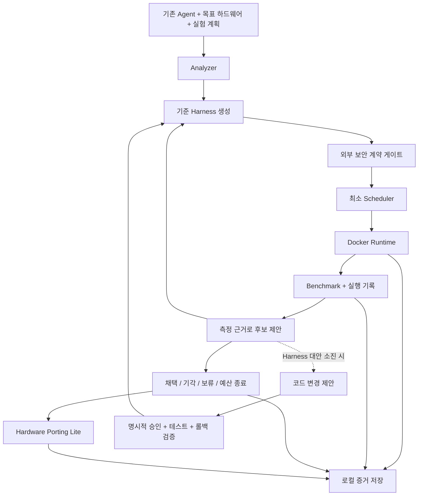

# 모듈별 책임과 인터페이스

## 1. 설계 수준과 선택

공통 계약·분석·Harness 패키징과 Phase 4 실행, Phase 5A~5B 데이터 파이프라인·비교·병목 가설·실험 계획을 구현했다. Simulator는 요구사항·Capability·선택적 Adapter·Mock에 한정한다. 후보 적용/실행·사용자 Agent·목표 장비·자동 최적화·Scheduler·보안 실제 연동·Porting Lite 전체 기능·Agent 코드 변경 승인은 후속 범위다. Incubation 데이터는 기록 스키마이며 자동 최적화 엔진이 아니다.

제어부는 Python 3.12 단일 프로세스로 시작한다. Pydantic v2 데이터 계약, 주입 가능한 실행·저장·외부 서비스 어댑터, 로컬 산출물 저장을 사용한다. Docker 실행 백엔드와 도메인 로직을 분리하고, 플랫폼 자체의 웹 서버나 상시 서비스는 우선 만들지 않는다. 후속 CLI는 orchestration을 호출하는 얇은 경계로 설계한다.

## 2. 실행 흐름과 의존성



모든 모듈은 `contracts`를 참조할 수 있다. Analyzer·Optimizer·Benchmark의 판단 로직은 Docker나 저장 파일을 직접 다루지 않는다. `orchestration`이 순서를 조정하고 `storage`·`runtime`·`security` 어댑터를 주입한다. `scheduler`는 작업과 자원 예약만 관리하며 후보 생성·채택 판단을 하지 않는다. 보안 판정과 Agent 코드 변경 승인은 서로 별개다.

## 3. 모듈 책임과 제안 인터페이스

아래 표는 전체 MVP 인터페이스 제안이다. contracts·analyzer·harness와 아래 13~15절의 Phase 4/5 API가 구현되었다. 나머지 함수는 후속 설계 표기다. 파일 쓰기는 Builder·LocalFilePipeline·JsonResultStore 어댑터에서 수행하며 명세 생성과 benchmark 판단은 외부 I/O를 하지 않는다.

| 모듈 | 책임 | 제안 인터페이스 | 경계 |
| --- | --- | --- | --- |
| `contracts` | 버전 있는 입력·출력·상태·오류 모델 | 아래 계약의 Pydantic 모델과 enum | 외부 I/O·최적화 규칙 없음 |
| `analyzer` | 정적 분석, 로컬 호스트 관측, 목표 호환성 | `AgentAnalyzer.analyze(path, agent_id=None, operational_requirements=None) -> AgentProfile`; `TargetProfiler(probe=None).profile_host() -> HostProfile`; `CompatibilityEngine.assess(agent, target) -> CompatibilityReport` | Agent import·실행·자동 설치 없음 |
| `harness` | 명세 생성·파일 렌더링·출력·무결성 검사 | `HarnessSpecificationGenerator.generate(agent, target, host, compatibility, request, operational_requirements=None) -> ContainerHarnessSpecification`; `ContainerHarnessBuilder.build(spec, agent, target, host, output_root, package_name=None) -> ContainerPackage`; `verify(directory) -> ContainerPackageManifest` | Docker·Agent 실행·원본 수정 없음; 후보 revise는 미구현 |
| `runtime` | Docker 사전 점검, 빌드·실행·정리 | `preflight() -> RuntimeCapability`; `build(HarnessBundle) -> ImageArtifact`; `execute(RunRequest) -> RunResult`; `cancel(run_id) -> CancelResult` | 추정 결과를 실측으로 반환하지 않음 |
| `benchmark` | 평가 계획, 결과 집계·비교 가능성·채택 기준 평가 | `evaluate(RunResult, BenchmarkPlan) -> BenchmarkResult`; `compare(baseline, candidate, BenchmarkPlan) -> ComparisonResult` | 컨테이너 직접 실행·유형별 처방 없음 |
| `optimizer` | 실행 증거로 제한된 후보 제안, 예산·중복 관리 | `propose(ExperimentHistory, Objective, SearchBudget) -> list[AdaptationCandidate]` | 자동 코드 변경·후보 자동 채택 없음 |
| `scheduler` | 단일 호스트 FIFO·예약·동시성·상태·취소 | `submit(JobSpec) -> JobRef`; `status(job_id) -> JobStatus`; `cancel(job_id) -> CancelResult` | 분산·선점·학습 정책 없음 |
| `security` | 별도 보안 하부 Agent 요청·응답 어댑터 | `review(SecurityReviewRequest) -> SecurityReviewResult` | 판정 엔진 개발 제외 |
| `porting` | 목표 호환성 평가와 이식 패키지 생성 | `assess(AgentProfile, HarnessBundle, TargetProfile) -> CompatibilityReport`; `package(PortingRequest) -> PortingPackage` | 에뮬레이션·VM·장비 배포 없음 |
| `approvals` | 코드 패치 승인·사본 적용·테스트·원복 증거 연결 | `request(CodeChangeProposal) -> ApprovalRef`; `apply_approved(ApprovalRecord) -> PatchTrial`; `rollback(PatchTrial) -> RollbackResult` | 원본 직접 변경·포괄 승인 없음 |
| `storage` | ID·해시·JSON 기록·산출물·이력 저장 | `append(Record) -> RecordRef`; `load(RecordRef) -> Record`; `put_artifact(ArtifactInput) -> ArtifactRef` | 채택 판단·Agent 분석 없음 |
| `orchestration` | 사전 조건, 기준선, 후보 반복, 게이트와 종료 | `incubate(IncubationRequest) -> IncubationReport` | 판단 로직은 해당 모듈에 위임 |

시간 제한·네트워크 호출은 어댑터에서 처리한다. 실행은 취소 가능한 작업으로 다루고, 구현 시 동기/비동기 호출 형태를 한 방식으로 통일한다. 로컬 파일 저장과 단일 조정자에서 시작하여 분산 메시지 버스는 도입하지 않는다.

## 4. 공통 데이터 계약

모든 계약에는 `schema_version`을 둔다. 실행·후보·이벤트는 UUID 식별자, UTC 시각, 상위 요청 ID를 포함한다. 측정값은 값·단위·출처·수집 시각을 묶고 미측정은 `null`로 둔다. 경계 입력은 알 수 없는 필드를 거부한다. 확장이 필요한 Agent 메타데이터는 명시적 `metadata` 필드로 제공한다.

| 계약 | 최소 필드와 의미 |
| --- | --- |
| `AgentManifest` | `agent_id`, 원본 경로·revision·SHA-256, `argv`, `working_dir`, 의존성 파일, 입력·출력, 요구 권한, 기능 테스트 `argv` |
| `AgentProfile` | 원본 참조, 런타임·의존성·진입점·장치 요구, 항목별 근거·신뢰 수준·unknown |
| `TargetProfile` / `HostProfile` | 목표와 실제 호스트를 분리. PlatformInfo·ResourceCapacity·RuntimeInfo·DeploymentCapabilities 독립 구성; 목표의 RESOURCE_SIMULATION·simulated_limits는 실측 용량과 별도 |
| `HarnessSpecification` | 구현된 최소 계약: Agent·원본 해시·목표·버전·부모 Harness·실행 방식·argv·이미지 관측·자원 제한·환경 비밀 참조. v1.0 계약 유지; Phase 3의 ContainerHarnessSpecification v1.1이 상속 확장 |
| `HarnessBundle` | `harness_id`, spec·원본 해시, Dockerfile·manifest·컨텍스트 파일 목록, 산출물 참조·해시 |
| `RuntimeCapability` | 실제 실행 호스트, Docker CLI·데몬·권한·아키텍처 지원 상태, 차단 원인 |
| `ImageArtifact` | 이미지 digest, Harness 참조, 빌드 실행 ID·로그·결과 |
| `RunRequest` | 이미지·Harness·입력·목표와 호스트 참조, 제한·seed·벤치마크·보안 검토 참조 |
| `RunResult` | `run_id`, 실제 호스트·이미지 digest, 시각, 종료 상태·exit code·timeout·OOM, 로그·원시 지표·오류·정리 결과 |
| `BenchmarkPlan` | 데이터·평가 해시, 워밍업·반복·seed, 지표·단위·집계법·목표 방향, 최소 개선·품질 한도·변동 판정 규칙 |
| `BenchmarkResult` | 실행별 Agent/Harness/Host/Target·실험 조건·지표·기능 검증 계약. Phase 4/5 실행별 생성과 Phase 5A~5B 반복 통계·비교를 제공하며 자동 최적화는 미구현 |
| `AdaptationCandidate` | HARNESS/DATA_PIPELINE/AGENT_CONFIGURATION/AGENT_CODE, 기준 Agent 버전·부모/결과 Harness·변경 필드/해시·이유·근거 실행·예상 효과·실제 검증·결정·코드 변경 증거. 실제 후보 생성·적용/실행은 미구현 |
| `ComparisonResult` | 기준·후보 참조, 비교 가능성·개선·품질 판정, `accepted/rejected/inconclusive`, 근거 |
| `SearchBudget` | 최대 후보 수·총 시간·예약 자원·개선 없음 횟수, 소비 기록과 종료 이유 |
| `IncubationReport` | 입력·기준·모든 후보·최종 결정 참조, 예산·종료 원인·미검증 항목 |
| `CompatibilityReport` | 구현된 Agent·목표 참조, 전체/항목별 FIT/ADAPT_REQUIRED/UNSUPPORTED/UNKNOWN·근거·미확인 항목. 정적 요구사항 적합성만 판정 |
| `PortingPackage` | 목표와 호환성 보고서, 포함 파일·각 SHA-256, 원본·Harness·이미지 참조, 생성 시각·제약·장비 검증 상태 |

`schema_version`의 major가 다르면 자동 해석하지 않고 명시적 마이그레이션을 요구한다. manifest 경로는 허용된 작업 루트 내부로 정규화하며 symlink·경로 탈출도 검사한다. 비밀 값은 JSON 계약과 로그에 포함하지 않고 참조로 전달한다.

## 5. 실행·최적화 상태 전이

Incubation의 주요 상태는 다음과 같다.

```text
registered -> analyzed -> baseline_prepared -> baseline_running
baseline_running -> evidence_ready -> proposing -> candidate_running -> evaluating
evaluating -> proposing | completed | inconclusive
각 단계 -> blocked | failed | cancelled
```

기준 실행이 실패해도 `evidence_ready`로 실패 근거를 전달할 수 있다. 이때 다음 후보는 실행 복구 목적이며, 성공한 비교 기준을 얻기 전 성능 채택은 금지한다. `completed`는 사전에 정한 인수 기준을 충족한 경우다. 비교 가능한 증거가 없거나 환경이 차단되면 `inconclusive/blocked`로 반환한다.

후보 상태는 `proposed -> gated -> built -> running -> evaluated -> accepted/rejected/inconclusive`다. 코드 후보는 `proposed` 다음에 정확한 승인·원본 보존·테스트 계획 확인을 추가한다. 실패·취소·승인 부재는 `accepted`로 전이할 수 없다. 결정과 근거는 별도 변경 불가 이벤트로 기록한다.

최적화 단계는 변경 가능 필드를 명시하되, 실제 근거에서 가설을 선택한다. 후보 중복은 부모 Harness·정규화 diff·평가 계획 해시로 감지한다. 동일 Agent 유형이라도 관측이 다르면 후보가 달라질 수 있어야 한다. 기존 Harness가 목표를 충족하면 변경 없이 종료할 수 있다.

## 6. 최소 Scheduler 설계

`JobSpec`은 Harness·RunRequest 참조, CPU·RAM·GPU 슬롯 요구, timeout, `exclusive_benchmark`를 포함한다. 기본 동시성은 1이고, FIFO 선두 작업의 자원이 확보될 때 실행한다. 후순위 우회·선점은 하지 않는다. 호스트 총량을 넘는 요청은 대기시키지 않고 `RESOURCE_UNSATISFIABLE`로 거절한다.

예약 획득·해제는 단일 잠금 아래 처리한다. 실행 완료·실패·timeout·취소 시 `finally` 경로로 반환한다. 독점 벤치마크는 다른 실행이 없는 상태에서 시작하고 이후 작업을 막는다. 취소 요청과 실행 종료의 경쟁은 최종 상태 한 번만 기록하는 방식으로 처리한다.

상태 전이는 `queued -> running -> succeeded/failed/cancelled`, `queued -> cancelled`다. 프로세스 재시작 시 기존 running 기록을 성공으로 간주하지 않는다. 기본 MVP는 상태를 `interrupted` 원인의 failed로 조정하고, 잔여 컨테이너를 조회·정리한 뒤 사용자가 새 실행을 등록하도록 한다. 자동 복구·중복 실행은 제외한다.

## 7. 보안 하부 Agent 계약

| 계약 | 필수 정보 |
| --- | --- |
| `SecurityReviewRequest` | 요청 ID·버전, 검토 단계, Agent·Harness·이미지 해시, 명령, 권한·마운트·네트워크·장치, 후보 diff, 요청 시각 |
| `SecurityReviewResult` | 같은 요청 ID·버전, `allow/deny/needs_review/unavailable`, 사유·발견 항목, 정책 버전, 검토 대상 해시, 응답·만료 시각 |

연동 방식은 HTTP 또는 로컬 어댑터 중 외부 팀 계약 확정 후 선택한다. 인증·timeout·응답 검증은 어댑터 책임이다. Harness 변경·이미지 변경·만료·요청 불일치가 있으면 기존 allow를 재사용하지 않는다. 빌드 전에는 생성 파일·권한을, 실행 전에는 이미지 digest와 실제 실행 설정을 검토할 수 있도록 단계를 구분한다.

외부 서비스 미제공·timeout·깨진 응답은 `unavailable`이며 기본 실행 게이트는 보류한다. 계약 테스트의 가짜 응답은 연동 계약만 검증하며 보안 검증 성공이 아니다. 별도로 명시된 제한적 로컬 시험 모드를 사용하면 보고서에 보안 미검증을 표시한다. 보안 엔진의 내부 규칙·탐지 기술·운영은 이 프로젝트 범위 밖이다.

## 8. Agent 코드 변경·롤백 경계

`CodeChangeProposal`은 Harness 대안과 실제 근거, 원본 해시, 정확한 패치·파일 범위, 변경 위험, 변경 전후 테스트, 롤백 절차를 포함한다. `ApprovalRecord`는 승인자·범위·시각·유효 기간과 원본·패치 해시를 묶는다. 승인을 요청하는 것과 승인되는 것은 다르다.

적용은 격리된 원본 사본에서만 한다. 승인 직전·적용 직전 해시를 확인한다. 테스트는 승인 범위의 기능·품질 조건을 검사하며, 변경 후 실행과 원복 후 재실행 증거를 남긴다. 성공 후보도 롤백 복원 가능성을 검증한 뒤 별도 사본으로 보존한다. 실패·취소는 원복하며 원본 저장 경로는 수정하지 않는다.

원복 결과에는 원본과 일치하는 파일 해시, 기능 테스트 결과, 잔여 패치·프로세스·산출물 점검을 포함한다. 승인 기록·전후 테스트·원복 증거 중 하나라도 없으면 코드 후보를 채택하지 않는다.

## 9. 산출물·오류·재현성

후속 전체 MVP 산출물 레이아웃 제안은 다음과 같다. Phase 4는 지정한 별도 디렉터리에 실행 UUID별 JSON을 저장한다.

```text
artifacts/<incubation_id>/
  inputs/             # 비밀 없는 manifest·목표 프로파일·원본 해시
  harnesses/<id>/     # 생성 Dockerfile·spec·컨텍스트 목록
  runs/<id>/          # 결과 JSON·stdout·stderr·원시 측정
  candidates/<id>/    # 근거·diff·비교·결정
  approvals/<id>/     # 패치 승인·테스트·롤백 참조
  porting/<id>/       # 준비 패키지·체크섬·검증 제한
  events/             # 순서 있는 변경 불가 이벤트
  report.json         # 전체 참조와 최종 상태
```

저장소는 경로 탈출을 막고 임시 파일 작성 후 rename으로 원자적 저장한다. 이미 사용한 ID는 덮어쓰지 않는다. 긴 로그·대용량 데이터는 파일 참조와 해시로 연결하고, 비밀을 마스킹한다. 데이터 보존 기간은 운영 도입 시 별도로 정한다.

공통 오류 계약은 `code`, 메시지, 단계, 요청·실행 ID, 재시도 가능 여부, 세부 원인·로그 참조를 가진다. 초기 코드 집합은 `INVALID_INPUT`, `ENVIRONMENT_UNAVAILABLE`, `BUILD_FAILED`, `RUN_FAILED`, `TIMEOUT`, `OOM`, `SECURITY_DENIED`, `SECURITY_UNAVAILABLE`, `APPROVAL_REQUIRED`, `APPROVAL_STALE`, `RESOURCE_UNSATISFIABLE`, `INCOMPARABLE_RESULTS`, `ROLLBACK_FAILED`로 제안한다. 오류 재시도 횟수는 예산에 포함하며 무한 반복하지 않는다.

## 10. Hardware Porting Lite 경계

정적 호환성 분석은 실행 성공과 별개의 증거다. 같은 아키텍처·의존성에서 실행한 결과도 다른 목표 장비의 성능 보장이 아니다. 패키지 생성 성공과 목표 실행 검증 여부를 별도 필드로 기록한다.

패키지에는 목표 프로파일, 호환성 보고서, 생성 Dockerfile·실행 manifest·의존성 자료, 파일 해시, 필요한 드라이버·장치·네트워크 요구, 준비·검증·롤백 안내를 넣는다. 불일치·unknown이 있으면 준비 자료로만 출력하고 실행 가능 표시를 하지 않는다. 비밀·원본 소스의 재배포는 기본 제외하며, 기존 Agent는 해시와 제공 위치로 참조한다. 이미지 교차 빌드·에뮬레이션·VM·실장비 배포는 호출하지 않는다.

## 11. 현재 구현 API와 범위

`contracts/base.py`는 Contract·Fact·EvidenceKind를, `profiles.py`는 Agent·Host·Target·OperationalRequirements·CompatibilityReport와 독립된 플랫폼·런타임·배포 구성요소를, `incubation.py`는 HarnessSpecification·BenchmarkResult·AdaptationCandidate·IncubationSession을 제공한다. 이후 인터페이스에서는 제안 단계의 HardwareProfile·HarnessSpec·Candidate 대신 위 이름을 사용한다. Phase 3는 ContainerHarnessSpecification과 ContainerPackageManifest v1.1을 추가했다. AgentManifest·BenchmarkPlan·PortingPackage 등의 나머지 계약은 아직 제안이며 HarnessBundle 역할은 현재 ContainerPackage가 담당한다.

| API | 동작과 한계 |
| --- | --- |
| `AgentAnalyzer.analyze(project, agent_id=None, operational_requirements=None)` | 정적 TOML·requirements include·AST 읽기. Agent import·subprocess·네트워크 없음. UTF-8, 파일 수/크기 한도, symlink·경로 탈출·개인 설정 제외. 오류는 AnalysisError의 code·path로 반환 |
| `TargetProfiler(probe=None).profile_host()` | LocalHostProbe 또는 주입한 HostProbe 사용. OS·아키텍처·ABI·논리 코어·총 RAM·PCI 그래픽 장치·Python·Docker CLI/로컬 접근 관측. CUDA·VM·미실행 컨테이너 지원은 UNKNOWN |
| `TargetProfile.simulate_resources(host, limits, name)` | 실제 HostProfile을 보존한 별도 TargetProfile 생성. 제한은 표현만 하며 적용·에뮬레이션 없음 |
| `CompatibilityEngine.assess(agent, target)` | OS·아키텍처·Python·물리 CPU/RAM·가상 제한·GPU·CUDA·실행 방식·Docker 전제조건 비교. 의존성 설치는 UNKNOWN. 유형별 최적화 정책 없음 |

모든 관측의 UNKNOWN은 null과 이유로 유지한다. 런타임과 배포 기능의 지원 여부에 추정·시뮬레이션 증거를 사용하지 않는다. Docker daemon query는 Unix 소켓에 한정하며 원격 DOCKER_HOST의 결과를 로컬 호스트 능력으로 수집하지 않는다. 정상 데몬 응답은 접근의 증거이며 컨테이너 실행 테스트의 증거는 아니다.

Agent 정적 분석은 설정 선언을 탐지할 뿐 실제 진입점 동작·환경변수 필수성·의존성 설치 가능성을 확인하지 않는다. 선택 의존성·동적 메타데이터·복잡한 pip 옵션·AST 이름의 런타임 재바인딩은 정밀 해석하지 않는다. `AgentSource.content_sha256`은 분석한 파일 목록과 각 해시의 결정적 지문이며 전체 Agent 백업을 대체하지 않는다.

IncubationSession의 iterations는 1부터 연속 번호이며 각 반복은 네 단계의 순서 있는 prefix 또는 완료된 네 단계다. 단계별 payload와 Agent/호스트/목표/원본/파생 버전 참조를 검증한다. 후보의 예상 효과는 ESTIMATED, 실제 검증은 별도 BenchmarkResult다. 품질이 저하되거나 실측이 없는 결과는 ACCEPTED로 기록할 수 없다. 코드 변경 증거는 참조 스키마만 구현했으며 승인·패치 적용·테스트 실행·롤백 실행은 구현하지 않았다.

CompatibilityReport의 FIT는 명시된 정적 요구사항에 대한 판정이며 Agent 실행 성공·보안 허가·성능 보장이 아니다. 다른 알려진 불일치가 있으면 UNSUPPORTED, 그렇지 않고 미확인 항목이 있으면 UNKNOWN, 그다음 조정 가능한 조건이 있으면 ADAPT_REQUIRED다. 실제 호스트 프로파일을 입력 목표에 자동 병합하지 않는다.

## 12. Phase 3 계약·생성·파일 어댑터

`contracts/harness.py`의 ContainerHarnessSpecification은 기존 HarnessSpecification을 상속하며 schema_version 1.1을 사용한다. v1.0 계약·기존 분석 API는 유지한다. 새 JSON은 새 클래스로 읽고, Baseline Runner는 이 명세와 ContainerPackageManifest의 버전을 확인해야 한다. 이 변경은 Harness 모듈의 확장이며 기존 모듈 구조를 바꾸지 않는다.

| 구성요소 | 책임 |
| --- | --- |
| ContainerHarnessRequest / BaseImage | 명시적 argv·이미지 참조와 지원 선언·작업 디렉터리·자원·환경 참조·소스 해시·설치 전략·운영 정책 |
| NetworkPolicy / SecuritySettings / BindMount | 요청 정책과 적용 가능한 설정 구분; non-root·capability·read-only 호환성·호스트 allowlist |
| HarnessSpecificationGenerator | 파일 I/O 없이 조건 병합·호환성 재검사·UNKNOWN/버전/의미 지문 생성. 필수 명령 누락과 UNSUPPORTED 차단 |
| ContainerHarnessBuilder | JSON/YAML·Dockerfile 렌더링, 별도 파일 어댑터로 소스 읽기·해시·비밀 검사·출력 경계·exclusive 쓰기·검증 |
| ContainerPackageManifest / PackageFile | 입력 ID·분석/복사 소스 지문·파일 해시/크기/권한·명세 해시·타깃/호스트/이미지 플랫폼·미검증 상태 |
| BuildxPlan | 단일/다중 linux/amd64·linux/arm64와 OCI 출력 인자 표현. 명령 실행·이미지 push·에뮬레이터 설정 없음 |

입력 지문은 Agent/Target/Host 의미 데이터와 연결되며 Builder가 명세 생성 후 입력 변경을 차단한다. source_bundle_sha256은 실제로 복사한 파일의 내용·권한 범위를 나타내며 analyzed_files 지문과 구분한다. 원본은 읽기만 하고 복사본의 권한에서 setuid 등 특권 비트를 제거한다.

생성 식별자는 입력 의미 데이터의 해시를 UUID5로 변환하며 created_at은 식별 해시에서 제외한다. 파일 바이트는 원래의 입력 시각도 포함하므로, 완전히 같은 저장된 입력 스냅샷을 재사용할 때 재현된다. 출력 경로 자체는 산출물 내용에 들어가지 않는다. Registry의 mutable tag·의존성 해제·실제 이미지 빌드의 재현성은 별도 문제다.

출력 파일과 manifest는 고정 이름을 사용하고, 소스는 검증된 상대 경로를 `agent/` 아래로 복사한다. 출력 루트는 기존 POSIX 디렉터리이며 child 디렉터리는 새로 생성한다. 경로 검사와 O_NOFOLLOW·O_EXCL·dir_fd로 symlink·기존 파일 쓰기를 차단한다. bind는 패키징 호스트에서 소켓·symlink·존재를 확인하고 실제 실행 호스트에서 다시 확인해야 한다.

패키지 환경변수는 이름과 secret:// 또는 env:// locator만 표현한다. Phase 4 호출자가 참조별 값을 메모리로 공급한다. 셸·inline Python 입력은 지원하지 않으며 installer build hook은 패키지 실행 승인 시 검토해야 한다.

Compose의 deny 설정과 allowlist 선언을 분리하며 선택적 egress 강제 도구는 구현하지 않는다. rootfs read_only는 호환성 확인에 따라 적용한다. 패키지는 실행 증거를 포함하지 않으므로 pending-validation profile과 false 플래그를 유지한다. Phase 4는 원본 패키지를 수정하지 않고 실행 증거를 따로 저장한다. Manifest 체크섬은 서명이 아니며 승인된 해시와 대조해야 한다.

## 13. Phase 4 구현 인터페이스

- `contracts/runtime.py`: ExecutionApproval, BaselinePlan, RuntimeRecord, BaselineResult. 기존 BenchmarkResult v1.0과 Phase 3 명세 v1.1은 변경하지 않는다.
- `orchestration.baseline.integrate`: manifest·승인 해시·입력 지문·실행 조건·환경 바인딩을 확인한다.
- `BaselineRunner(runtime: Runtime, store: ResultStore).run(...)`: 승인된 사본, 빌드·실행·정리·반복·실패 보존을 조정한다. runtime과 storage는 Protocol로 주입한다.
- `runtime.docker.DockerCLI`: 로컬 Unix Docker Engine을 제어하는 신뢰된 호스트 어댑터. subprocess 목록 인자·cwd·timeout·프로세스 그룹 종료·양쪽 pipe 크기 제한을 적용한다.
- `benchmark.baseline.evaluate`: I/O 없이 RuntimeRecord를 기존 BenchmarkResult로 변환하고 명시적 기대 stdout을 평가한다.
- `storage.baseline.JsonResultStore.save`: 실행 UUID별 결과·계획·승인을 원자적·비덮어쓰기 JSON으로 저장한다.

Package의 false 실행 플래그는 정적 산출물의 상태이며 실제 실행 기록과 별개다. Phase 4 결과는 원본·Harness 버전·소스 bundle·manifest·명세·이미지·실행·승인 ID를 연결한다. 자세한 API·측정 정의·검증 범위와 한계는 [실행 안내](PHASE4_BASELINE.md)를 따른다.

## 14. Phase 5A~5B 데이터와 실측 판단 경계

- contracts/data: 선언·승인·스키마·버전·검증·Metric·Replay 연결. 기존 ResourceLimits·Fact·Metric·ValidationStatus를 재사용한다.
- analyzer/data: AgentProfile 해시를 확인한 AST 관찰·사용자 계약 보완. Agent 실행/데이터 임의 접근 없음.
- data/local: DataSourceAdapter 경계와 실제 로컬 파일 구현. 승인·hash 검증, 고정 descriptor·bounded streaming/buffer, private staging/atomic publication, 불변 artifact·복원/Replay.
- harness/builder: 선택적 prepared_data를 기존 manifest에 포함하며 실제 bytes/schema/count를 재검사한다. optional data_requirement로 pipeline 구성 hash를 Harness 식별에 연결한다. 기본 기존 공개 인자와 무데이터 JSON을 유지한다.
- orchestration/baseline: 기존 승인·검증·실행·저장을 재사용하고 데이터 검증/버전을 연결한다. 자동 후보 적용이나 Agent 코드 수정 없음.
- benchmark/comparison, bottleneck: filesystem/Docker 호출 없는 비교·통계·품질 gate·관측 가설. Agent 유형별 최적화 처방 없음.
- contracts/optimization: 기존 AdaptationCandidate/AgentVersion/ExpectedEffect/CandidateDecision과 연결한 계획·예산·범위·결과 계약. 실행 권한/변경 적용은 false다.

공통 semantic hash는 contracts/base에 두고 기존 harness._utils.content_hash import를 유지한다. Contract metadata의 created_at만 제외하며 데이터 schema의 비즈니스 필드 이름 created_at은 hash에서 제거하지 않는다. BaselineResult·ExperimentConditions에 새 optional 정보만 추가하고 None/빈 값은 기존 JSON에서 생략한다. 자세한 측정 정의와 Linux/패키지 한도는 [Phase 5 안내](PHASE5_FOUNDATION.md)를 따른다.

## 15. Simulator Integration 책임 분리

SimulatorRequirement/Capability/Response는 순수 계약이며 선택적 capability별 지원/미지원/UNKNOWN과 증거 종류를 보존한다. Incubation Engine은 요구사항·실행 결과를 분석/평가하고 Porting Manager에 계약을 전달한다. Porting Manager의 simulator Adapter 경계가 선택·연결·환경 설정/검증·센서/상태 파이프라인·명령 변환·연결 상태/timeout/error를 맡는다. Incubation Engine에서 simulator I/O를 호출하지 않는다.

현재 porting/simulator.SimulatorAdapter는 공통 invoke와 optional 동작 wrappers만 제공한다. 실제 backend가 없으면 성공을 꾸미지 않는다. Mock은 테스트에만 있으며 응답은 SIMULATED다. 실제 Porting Manager의 연결 관리자, PX4/Gazebo/ROS 2/AirSim backend, 하드웨어 에뮬레이션은 구현하지 않는다. 시뮬레이터 상태·센서 dataset과 실제 장비 실측을 혼동하지 않는다.
